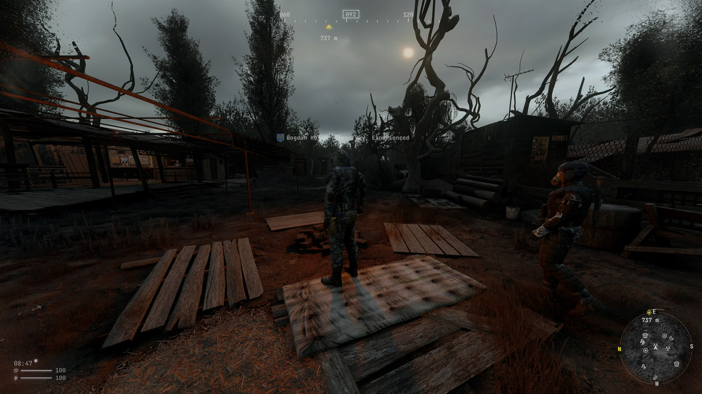

# ZoneOS

**HUD, UI and PDA overhaul for S.T.A.L.K.E.R. Anomaly and G.A.M.M.A.** 0.5.1-alpha, a public alpha for testing.

Your PDA sets the tier. Find a better one and the whole interface steps up with it: the PDA screen, the map, the inventory,
trading and crafting, and the HUD if you want it to.

- **The manual at a glance:** [ZoneOS_Manual_0.5.0-alpha.pdf](ZoneOS_Manual_0.5.0-alpha.pdf) (written for 0.5.0)
- **Download:** [Releases](https://github.com/estebanaraya/zoneos/releases)
- **Bugs and ideas:** [Issues](https://github.com/estebanaraya/zoneos/issues)

## What's new in 0.5.1-alpha

- **Fewer crashes:** opening the PDA after a load, taking a Wearable Devices device off in the inventory, and switching
  screens just after an e-paper page flash
- **The Map follows your PDA:** a new PDA's look applies at once, with no reload
- **Start on:** the PDA key opens Home, the Map or the Last screen you were on (Settings, PDA look, More)
- **One box per equipment kind:** the Knife, Sidearm and Binoculars boxes take only their own kind; a wrong drop goes to
  the item's own box
- **More weapon chips:** canted sights, tactical lights, weapon kits and speed loaders. Drop a part on its chip to fit it,
  right-click the chip to take it off
- **Preview before you use:** hover food, medicine or an artefact and the Condition and Protection rows show what it would
  change
- **Needs read like the game:** hunger, thirst and sleep count up to 100 at the game's red indicator
- **Item effects read right:** bad effects red, good ones green, with the game's signs; parts show their condition dots
- **Stacks:** every cell in the stack picker has its hover card; Group by type rows no longer overlap
- **People by standing:** hostiles are diamonds, allies circles, neutrals squares, on every map and the minimap
- **The HUD is ZoneOS's own:** the game's HUD toggle no longer hides it; its switch in Settings, HUD does
- **Faction themes:** Theme (Settings, PDA look) gives the Advanced and Phosphor screens and the inventory Promin's colours
  or a faction's (12 to pick from, by emblem)
- **CRT on Phosphor:** the CRT switch darkens the Phosphor screen's edges, with a glow on the raised PDA under shader bus v8;
  the Advanced screen's scanlines are gone

The full list is in `README.md` in the zip.

## Requirements

- G.A.M.M.A. (built and tested on installer 920)
- Modded Exes 2026.10.11 or later. The installer's own exes are older and lack the map widget; on those, ZoneOS switches
  itself off.
- Wearable Devices 0.9.2 or later. G.A.M.M.A. ships 0.8.14 switched off, so install 0.9.2
  separately. Without it ZoneOS loads, shows one message at start, and the parts that read the devices stay blank.
- DX10 or DX11

Built on the CLIKRΔD ROMEO list and checked against plain G.A.M.M.A.: nothing else from ROMEO is required.

## Install

1. Install the zip with MO2.
2. Place it low in the load order, below G.A.M.M.A.'s UI mods. The folder is `Z_PDA_Redesign`.
3. Start the game. Settings live in the PDA (Profile, Settings), in MCM, and in the HUD editor.

## The four tiers

| Tier | PDA | HUD (with Follow PDA) | Screen, map and menus |
| --- | --- | --- | --- |
| 1 | PDA 1, or none | Gen 2: phosphor | Phosphor, green or amber, with CRT edge darkening |
| 2 | KilTrak v2.0 | Gen 1: one ink | E-paper, paper white or paper black |
| 3 | v3.1 | Gen 3: full colour | Advanced: the PROMIN look of Wearable Devices |
| 4 | Milspec | Gen 4: a lighter ink | Advanced, as v3.1, with an optional night look while NV is on |

The HUD starts on Gen 3. Set HUD style (Settings, HUD, How it looks) to Follow PDA to tie it to the PDA you carry, or pick
any look and keep it. Each look has its own boot sequence and its own critical-vitals alert.

## Features

### Inventory, trade and loot

- Search as the last Sort tab; in a stash one field searches both panes
- Type filters on the backpack
- Group by type: categories fold like an accordion, while looting too. Stashes can group as well (Settings, Inventory,
  Backpack; off by default)
- Move all and Take all also take folded items
- Total carry weight under every Sort tab
- Right-click works on every box
- Drop onto equipment: a module on the Promin, a filter or tank on the helmet or Air box, a scope on a scoped weapon (they
  swap), an item on an empty Belt box. With SOTA, a consumable on Ready box N sets its key
- A hint says why when a drop does not fit
- Equipment pane with the Wearable Devices slots (Forearm, Wrist, Bracer, Patch, Side)
- Weapon chips: magazines (Mags Reloaded), canted sights, tactical lights, weapon kits and speed loaders, fitted by drop and
  removed by right-click
- Knife, Sidearm and Binoculars boxes take only their own kind; with two primaries, the knife key twice draws the sidearm
- Hover a consumable or artefact to preview what it would change
- Chest rigs: the plate sits in the rig, med pockets, and SOTA rigs, pouches and Ready supplies in the same look
- Item details: a floating two-column sheet with attachments, the upgrade tree and a rig's pocket layout
- Trade sets apart what the trader will not buy
- See-through glass over the game, or flat, with a backing darkness setting

### Crafting

- One grid for every workshop mode: portable workshop, cooking, mending, artefact melter, repair
- Available only, and a prominent search
- Bench upgrade trees with path lines and kit art

### HUD

- A HUD in place of the game's own, on its own switch: no PDA, charge or headgear needed, and the game's HUD toggle does
  not hide it
- HUD style: Gen 1, Gen 2, Gen 3, Gen 4, or Follow PDA, plus an intensity setting
- Every part its own switch: bars, status chips, full messages, quick slot icons, long hints, limb hit points, map marks
  and their colours, squads on the map, name and rank on the ID line
- Name tag of the person you look at
- HUD editor: drag clusters, scale and fade them; tabs for Look, ID line, Weapon, More, Parts and Controls. Open it from
  Profile, Settings, HUD, or from MCM
- Presets: Default, PROMIN Hardcore, Unrestricted. They only change settings
- Quick slots fade 4 s after use, or stay shown
- The HUD hides while you zoom a binocular or rangefinder, and comes back when you lower it
- This release has no weapons HUD: the round count and fire mode draw as a small note

### PDA

- Every page redrawn: Home, Tasks, Map, People, Messages, Guide, Radio, Profile and Settings
- Map: filters, pan, zoom, Centre on player, a right-click menu; zoom and pan stop at the world edge
- Faction themes picked by emblem; Start on: Home, Map or Last screen
- Level exits as one exit icon; clicking a spot on a preview opens the Map on it
- Text size: Smaller, Default or Large. Icon style: Pixel (the default) or Line
- Every setting in the PDA's Settings, MCM and the HUD editor; every key on Controls
- Talk window and use prompt in the PROMIN look, with GFY faces
- Better Beef's NVGs bloom held at 0 while the PDA is up
- Prepare for uninstall: one press readies a save

### Wearable Devices

Off by default. Turn on Follow Wearable Devices and each HUD element draws only while a device reads it. Nothing a lit
Promin page shows is drawn twice, and a worn watch takes the clock off the HUD.

| HUD element | Read by |
| --- | --- |
| Clock | Promin, Vektor or Ulman's Watch |
| Vitals and limbs | Promin or Vektor |
| Hazards | Environmental Module, Vektor-2M or a Geiger |
| Compass | Navigation Unit or Vektor |
| Minimap | Navigation Unit |
| Notifications | Promin |

## Engines and shader effects

The PBR engine build (maka-pbr-test) runs ZoneOS; clear the shader cache when you switch engines. Modded Exes with shader
bus 7 run everything, and the bus 8 effects fall back. The PR 805 exes (shader bus v8) run everything on DX10 or DX11 with
MSAA off; the DX11 rows below need DX11.

| Effect | PR 805 (bus v8) | PBR or Modded Exes (bus 7) |
| --- | --- | --- |
| HUD light (DX11) | Follows the world behind it | Fixed |
| 3D PDA sun glare | Glint on the glass | None |
| Weapon menu light | Masked by hands and weapon | Depth cut at 1.2 m |

Each fallback logs one `[pdar]` line. The round HUD map needs any bus; the glow on the raised Phosphor PDA needs bus v8.

## Coming later

A separate hardware add-on: AR visor modules and a headset that tie the HUD to your gear, thermal modules, binocular tiers,
the C-Consciousness module and world marks on people. Until then the binoculars are G.A.M.M.A.'s own.

## Known issues

- Performance: the HUD costs 0.3 to 0.7 ms a frame while on (budget 0.2 ms); the inventory and map up to 2.3 ms a frame at
  1080p while open. Fixes are in progress.
- A modpack update reset one player's ZoneOS settings to their defaults; the cause is not found. After updating, check
  Settings.
- Item details for a weapon lists fewer attachments than its hover card, shows a stray row under the picture, and its
  description can overlap the properties.
- In one play test the first PDA open after a load showed the game's own PDA. A fix is in 0.5.1; tell us if you see it.
- The Gen 4 name tag draws fainter than at Gen 2 and Gen 3 and is easy to miss on a dark scene.
- Notifications switch on the next load; the other elements switch live.
- Map icons: on wide screens the PDA map draws the game's icons at their true place. An icon wholly under another is not
  drawn, and one just past the edge may not show.
- Inventory drag and drop: a drop on one of an equipment box's small chips is refused unless the item goes in that chip;
  drop it on the box away from the chip.
- In-game checks ran at 4K and 1080p. 1440p, 4:3, 16:10 and Russian have not been re-run for ZoneOS.
- The Russian text is machine-translated and unreviewed.
- Mods outside the ROMEO list may interact in ways we have not seen. Tell us in the issues.

## Credits

This is an alpha and the credits are still being completed. If your work is missing or credited wrongly, tell us in the
issues.

- **Wearable Devices:** Sulik, Jeremussy, Wiarubane. Used with their permission (2026-10-16): the CRT edge fade, the stat
  rule `get_state` and the BIO body silhouette. Everything else of Wearable Devices is read at run time, not copied.
- **S.T.A.L.K.E.R. Anomaly:** the Anomaly team, on GSC Game World's engine and assets.
- **G.A.M.M.A.:** Grokitach and the G.A.M.M.A. team. MCM, SortingPlus and Encyclopedia Messages Restored: RavenAscendant.
- **Modded Exes:** demonized and contributors (shader scaffold, map widget, DLTX, DXML).
- **Shader bus v8:** TheLostInPlace, xray-monolith PR 805.
- **Fonts:** JetBrains Mono and IBM Plex Sans (SIL OFL 1.1).
- **Line icons:** picked one by one from Lucide 0.400.0 (ISC), Tabler Icons 3.19.0 (MIT), Phosphor Icons 2.1.1 (MIT) and
  Iconoir 7.9.0 (MIT). The pixel icons and the other line icons are drawn for this project.

**Works with** (read or called at run time, no code included): iTheon (PDA Taskboard), lizzardman (Custom Taskboard, FDDA
Redone), Serious (Tasks QoL Pack), Catspaw (Personal Adjustable Waypoint, New Extensible RF Sources), Utjan (Item UI
Improvements, QoL Bundle), HarukaSai (Dynamic Icons Indicators), Redotix99, Andtheherois, party50 (3DSS), Priler (Toxic
Air Redux, Ammo Check), Erandis (FART), INC and strangerism (Enhanced GUI talk window), CrookR (Identification UI),
Ascii1457 (Screen Space Shaders), Meowie (Reworked Devices), Mich (Boomsticks and Sharpsticks), IndieSunpraiser and
theRealBeef (Better Beef's NVGs), Tweaki_Breeki, G_FLAT, Minimal SOTA+ Complete.

Thanks also to LostInPlace, Godemis, Leekos, Bling and everyone who has given feedback and support.

The full list, licences and provenance: `CREDITS.md` and `licenses/` in the zip.

This project was built with Claude.
