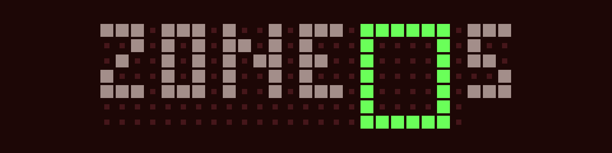

# zoneOS

**HUD, UI and PDA overhaul for S.T.A.L.K.E.R. Anomaly and G.A.M.M.A.** 0.5.1-alpha, a public alpha for testing.

Your HUD and interfaces evolve as you upgrade your PDA, giving a fresh experience as you progress. If you want to keep a
specific look, you can always go into the settings and customize it exactly the way you want it.

**[Download](https://github.com/estebanaraya/zoneos/releases)** · **[Guide](https://estebanaraya.github.io/zoneos/)** ([PDF](ZoneOS_Guide_0.5.1-alpha.pdf)) ·
**[Manual at a glance](ZoneOS_Manual_0.5.1-alpha.pdf)** · **[Bugs and ideas](https://github.com/estebanaraya/zoneos/issues)**

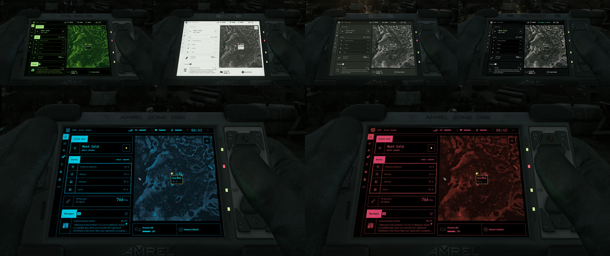

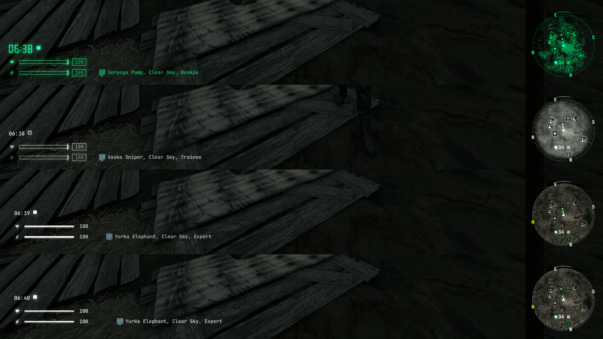

## Gallery

| | |
| --- | --- |
| 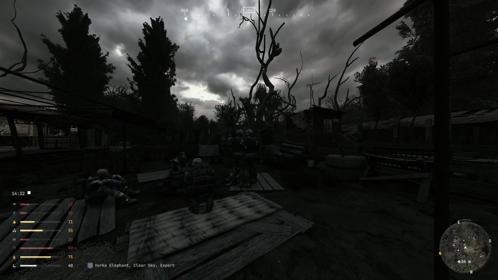 The Gen 3 HUD | 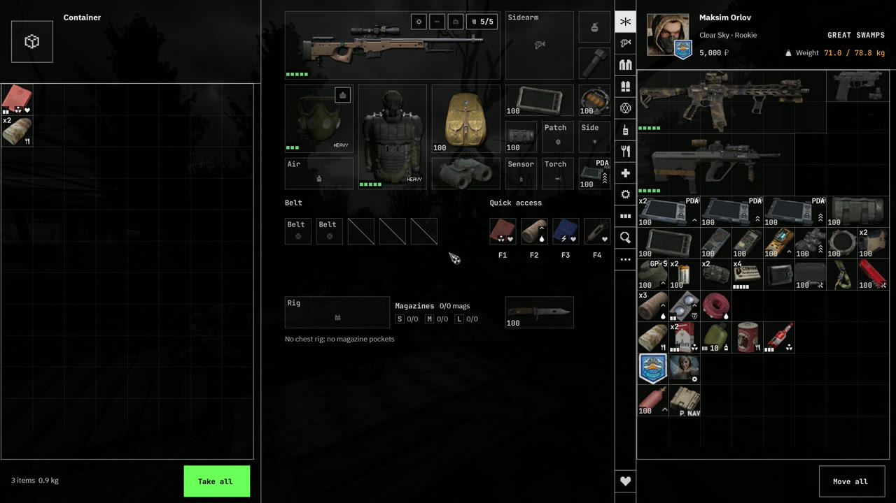 Loot on Gen 3 glass |
| 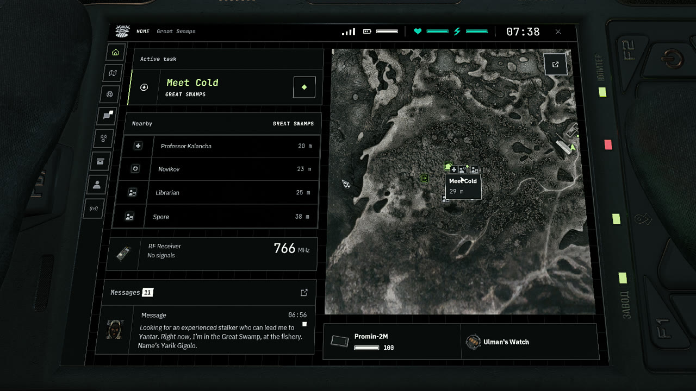 Home on the Milspec's OLED screen | 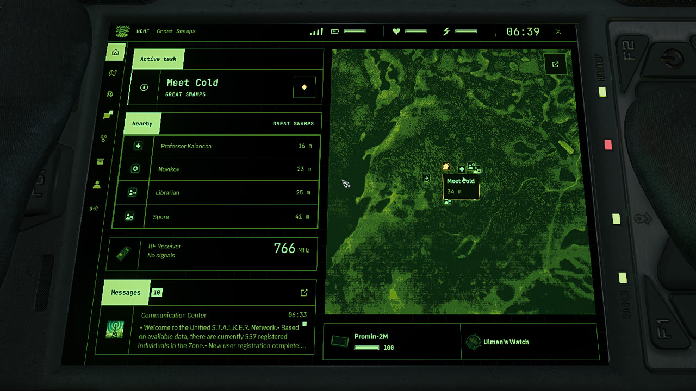 Home on PDA 1's Phosphor screen |
| 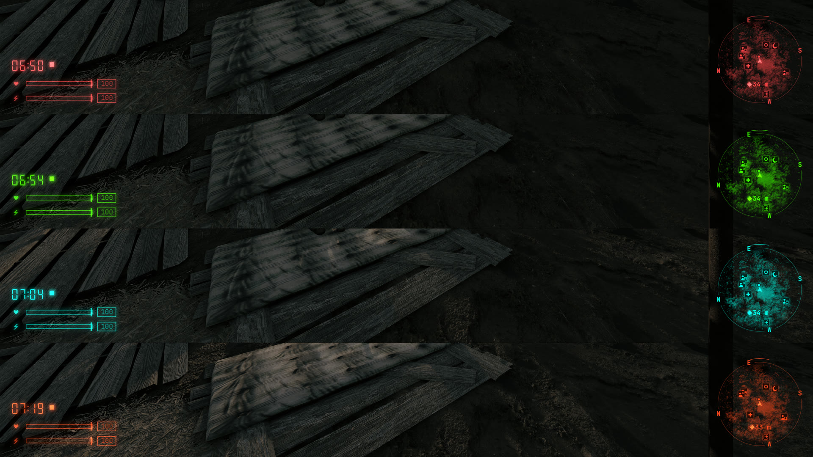 Faction themes on the HUD | 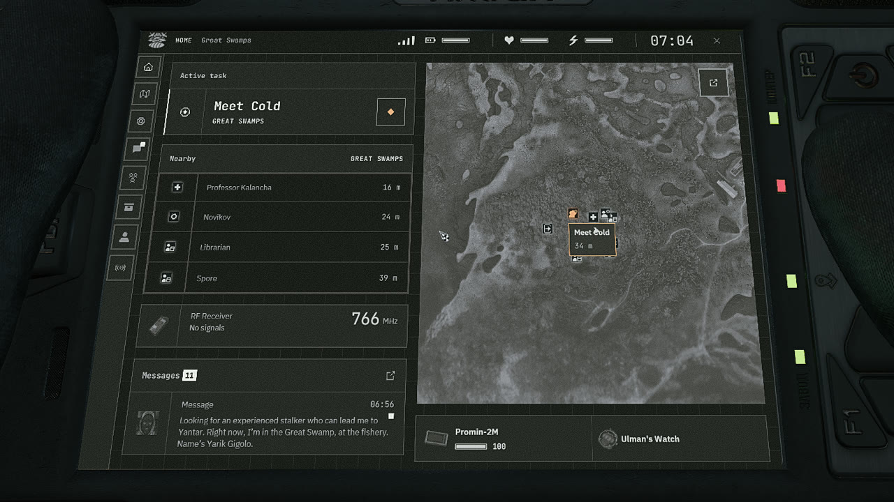 Home on the KilTrak's E-paper screen |
| 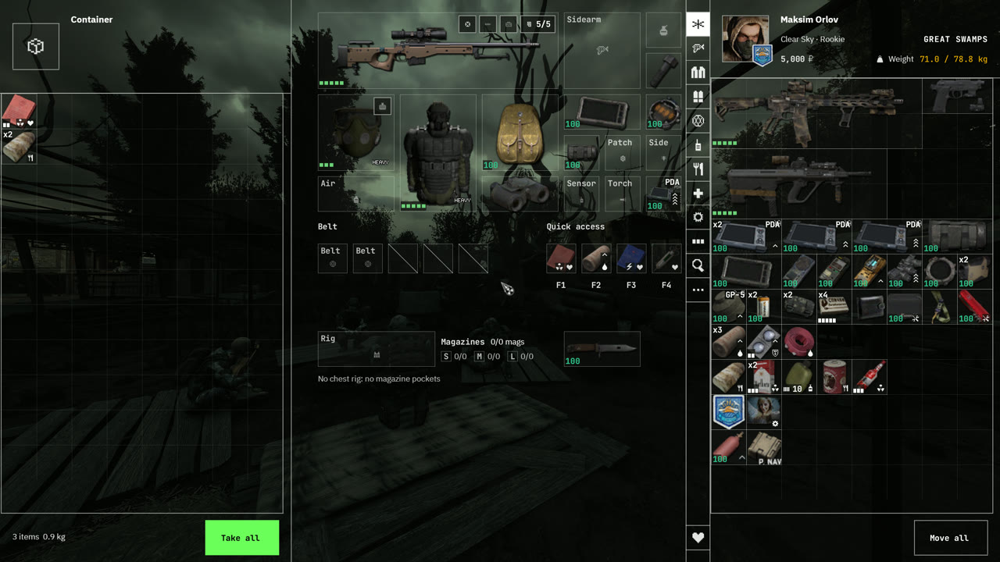 Loot on Gen 4 glass | 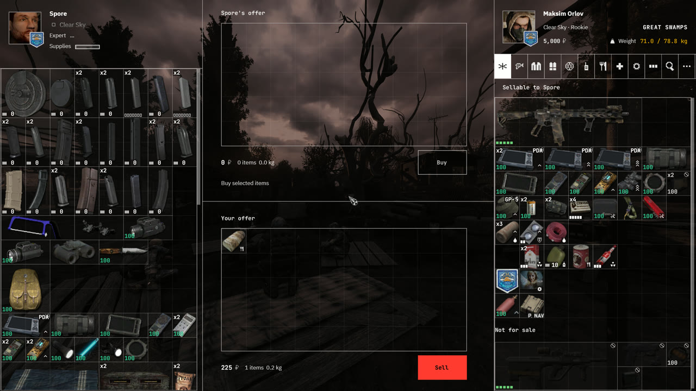 Trade under the ROMEO theme |
| 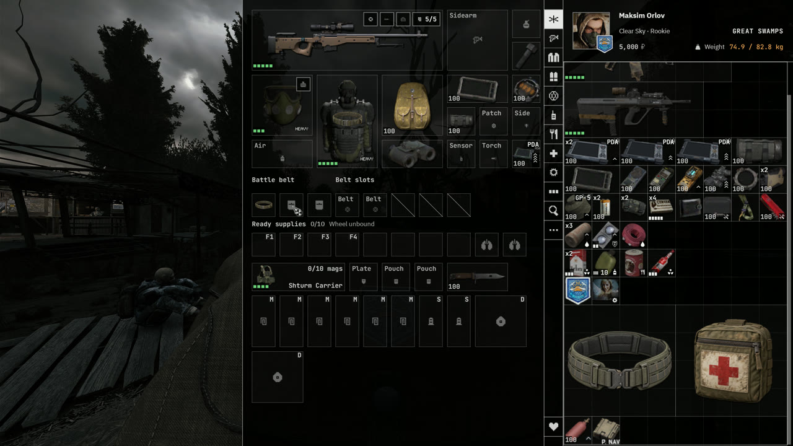 Battle belt, Ready supplies and a chest rig | 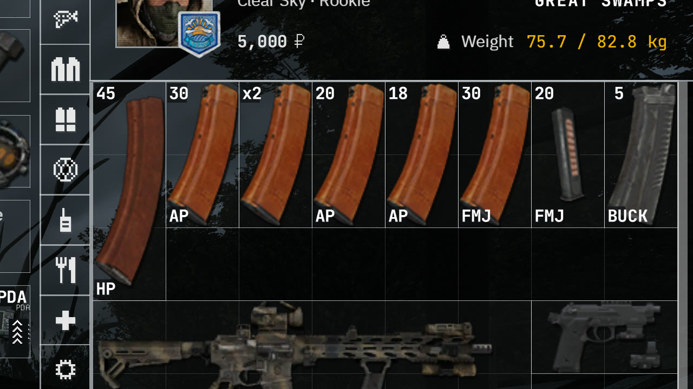 Magazines show their rounds and ammo type |
| 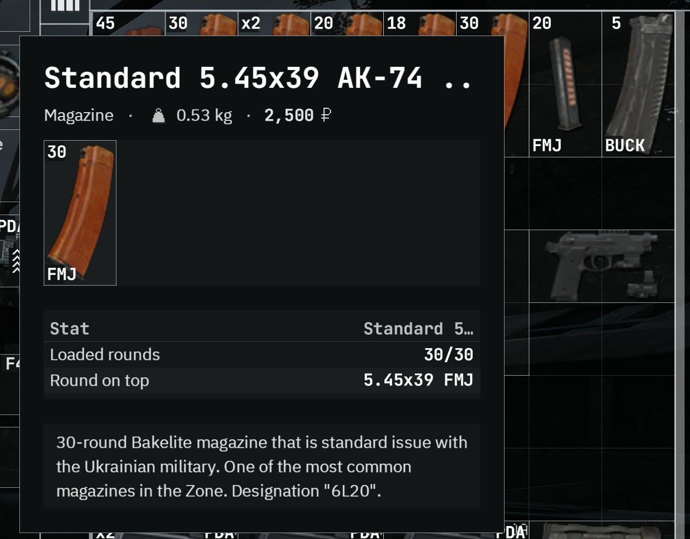 The magazine card | 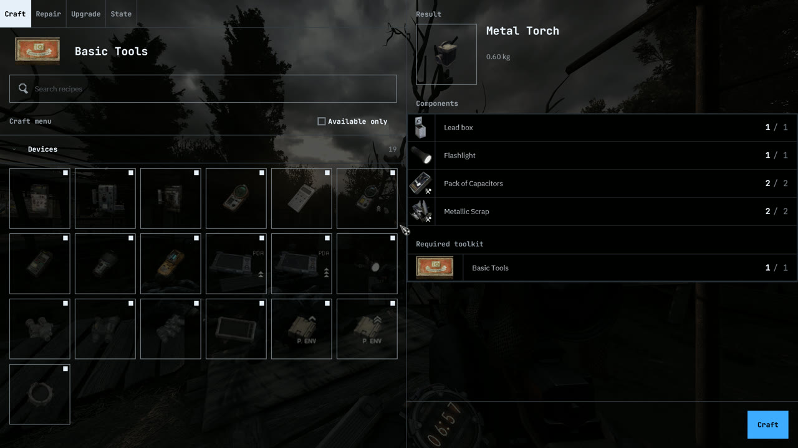 The crafting menu |
| 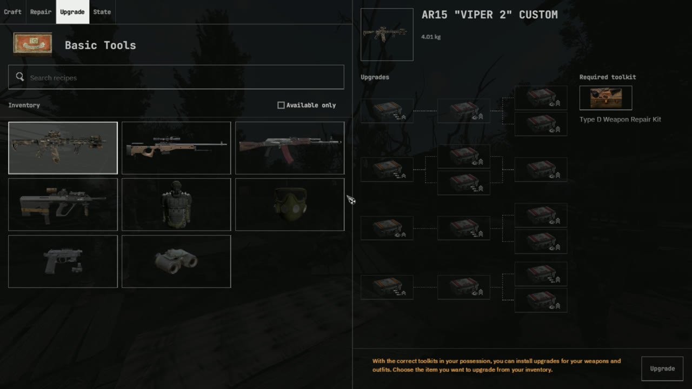 The upgrade tree | 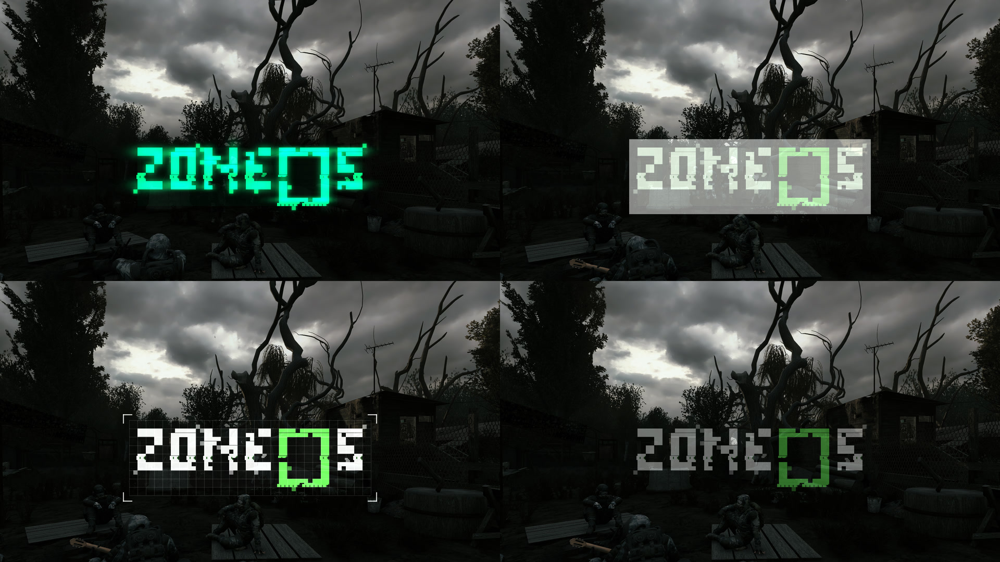 The start animation in its four looks |

## Features

- Completely revamped UI and UX for the base G.A.M.M.A. and ROMEO experience
- Dozens of quality-of-life improvements across the board, including search in your stash, patches as attachments, and more
- Unique themes per faction
- Built-in support for rigs, battle belts, and magazines
- Four tiers that follow your PDA: Phosphor, E-paper, Colour e-paper and OLED screens, each with its own HUD look and
  inventory glass
- Every PDA page redrawn: Home, Tasks, Map, People, Messages, Guide, Radio, Profile and Settings
- Our own map marks: hostiles are diamonds, allies are circles, neutrals are squares
- A HUD in place of the game's own, on its own switch, with a HUD editor to drag, scale and fade each cluster
- Inventory, trade and loot as see-through glass over the game
- One crafting grid for every workshop mode
- Every setting in the PDA's Settings, MCM and the HUD editor

The guide shows every look and every function.

## Requirements

- G.A.M.M.A. (built and tested on installer 920)
- Modded Exes 2026.10.11 or later. The installer's own exes are older and lack the map widget; on those, zoneOS switches
  itself off.
- Wearable Devices 0.9.2 or later, required. G.A.M.M.A. ships 0.8.14 switched off, so install 0.9.2 separately.
- DX10 or DX11

Built on the CLIKRΔD ROMEO list and checked against plain G.A.M.M.A.: nothing else from ROMEO is required.

## Install

1. Install the zip with MO2.
2. Place it low in the load order, below G.A.M.M.A.'s UI mods. The folder is `Z_PDA_Redesign`.
3. Start the game. Existing saves load. Settings live in the PDA (Profile, Settings), in MCM, and in the HUD editor.

To remove it, press Prepare for uninstall first (Profile, Settings, PDA look, More); the zip's README has the steps.

## Known issues

This is an alpha: expect rough edges. The guide and the zip's README list the known issues; tell us what you find in
the [issues](https://github.com/estebanaraya/zoneos/issues).

## Credits

This is an alpha and the credits are still being completed. If your work is missing or credited wrongly, tell us in the
issues.

- **Wearable Devices:** Sulik, Jeremussy, Wiarubane. Used with their permission (2026-10-16): the CRT pattern, the stat
  rule `get_state` and the BIO body silhouette. Everything else of Wearable Devices is read at run time, not copied.
- **S.T.A.L.K.E.R. Anomaly:** the Anomaly team, on GSC Game World's engine and assets.
- **G.A.M.M.A.:** Grokitach and the G.A.M.M.A. team. MCM, SortingPlus and Encyclopedia Messages Restored: RavenAscendant.
- **Modded Exes:** demonized and contributors (shader scaffold, map widget, DLTX, DXML).
- **Fonts:** JetBrains Mono and IBM Plex Sans (SIL OFL 1.1).
- **Icons:** line icons picked one by one from Lucide 0.400.0 (ISC), Tabler Icons 3.19.0 (MIT), Phosphor Icons 2.1.1 (MIT)
  and Iconoir 7.9.0 (MIT); pixel icons from the HackerNoon Pixel Icon Library 1.1.0 (CC BY 4.0), Pixelarticons 2.4.2 (MIT)
  and Pixicons 1.0.39 (MIT). The other icons are drawn for this project.

Every mod zoneOS works with, the licences and the provenance: the guide, and `CREDITS.md` and `licenses/` in the zip.

Thanks also to LostInPlace, Godemis, Leekos, Bling and everyone who has given feedback and support.

This project was built with Claude.
